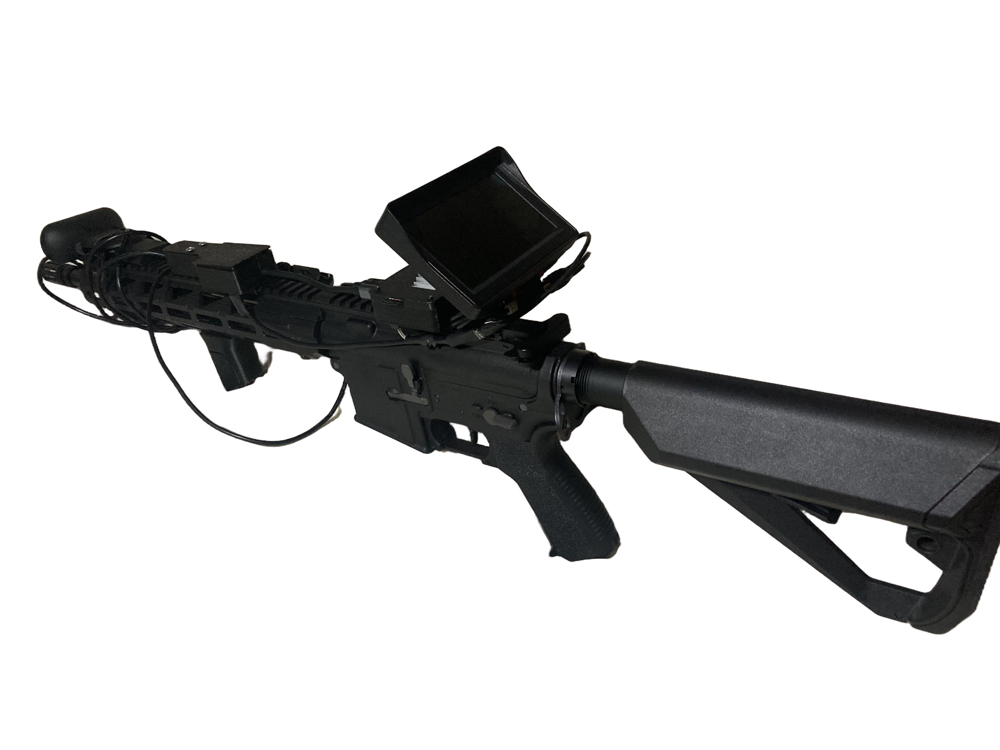

# OScope

OScope is an OpenCV camera viewer with Human, Drone, ect. detection and motion prediction, named as "OpenScope"

It is a (Airsoft!!!) target prediction algorythm that detects where something is going, and tells you where to shoot.

The hardware is: A Radxa Cubie A7S, Display (if a/v, then also a usb-c dp alt to a/v converter), High speed camera eg: OV9281 and a power source like a power bank.



## Models

| Display name | File | Source |
| --- | --- | --- |
| Animals, Balls, Cars / vehicles, Other objects | `yolo11n.pt` | Ultralytics |
| Lite gun | `gunnknife.pt` | [gun-knife-yolo11n](https://huggingface.co/cosgun99/gun-knife-yolo11n) |
| Drones | `Drone.pt` | [Drone-Detection-YOLOv11x](https://github.com/doguilmak/Drone-Detection-YOLOv11x) |


## Backend selection

`HPP_YOLO_BACKEND=auto` selects Ultralytics/PyTorch and `.pt` on amd64, and the native A733 NPU backend and `.nb` models on the Radxa Cubie A7S. Use `cpu` or `npu` to override the selection where supported.

On the Radxa, run `./build_a733.sh` before starting the application. The script cross-compiles `liba733_npu.so`.

## Install

### Radxa Cubie A7S prerequisites

Use the stock Radxa OS image, or even any SBC probibly works with a A733 but I give no guarantee. 

Install the system packages needed: Python environment, and A733
native build:

```bash
sudo apt-get update
sudo apt-get install -y \
	build-essential cmake curl file unzip \
	gcc-aarch64-linux-gnu g++-aarch64-linux-gnu \
	python3-venv python3-numpy python3-opencv \
	v4l-utils \
	gstreamer1.0-tools gstreamer1.0-plugins-base-apps gstreamer1.0-plugins-good
```

### Put the files on the Radxa

`start-OScope.sh` expects the project at exactly
`/home/radxa/Documents/OScope`. Copy or extract the complete project there.

From the GitHub Releases page, download `PUT-INTO-ROOT-DIR.zip` and extract its
contents into `/home/radxa/Documents/OScope`,
The A7S models must be in
`/home/radxa/Documents/OScope/npu_models/` with their existing `.nb` names.

If you also downloaded `allwinner-model-zoo.tar.gz`, put it here:

```text
/home/radxa/Documents/OScope/native/a733_npu/.deps/allwinner-model-zoo.tar.gz
```

### Create the Python environment.


```bash
cd /home/radxa/Documents/OScope
python3 -m venv --system-site-packages venv2
source venv2/bin/activate
python3 -c "import cv2, numpy; print('OpenCV', cv2.__version__, 'NumPy', numpy.__version__)"
deactivate
./build_a733.sh
```
`build_a733.sh` creates `liba733_npu.so` and `npu_runtime/`, which the app needs
for NPU inference.

## Run

From an SSH session on the Radxa:

```bash
cd /home/radxa/Documents/OScope
./start-OScope.sh
```

The camera window opens fullscreen on the device's `:0` display (USB-C Alt DP mode). The settings open on
`http://<radxa-lan-ip>:8765` from a browser on the same LAN. 

Use `--windowed` to keep the camera window resizable.

`--web-port` to change the port.

Profiles can be selected with `HPP_PROFILE=pc`, `HPP_PROFILE=radxa-a7s`, or `HPP_PROFILE=legacy-arm`. `HPP_YOLO_IMGSZ` and `HPP_YOLO_HZ` can tune CPU inference load.
